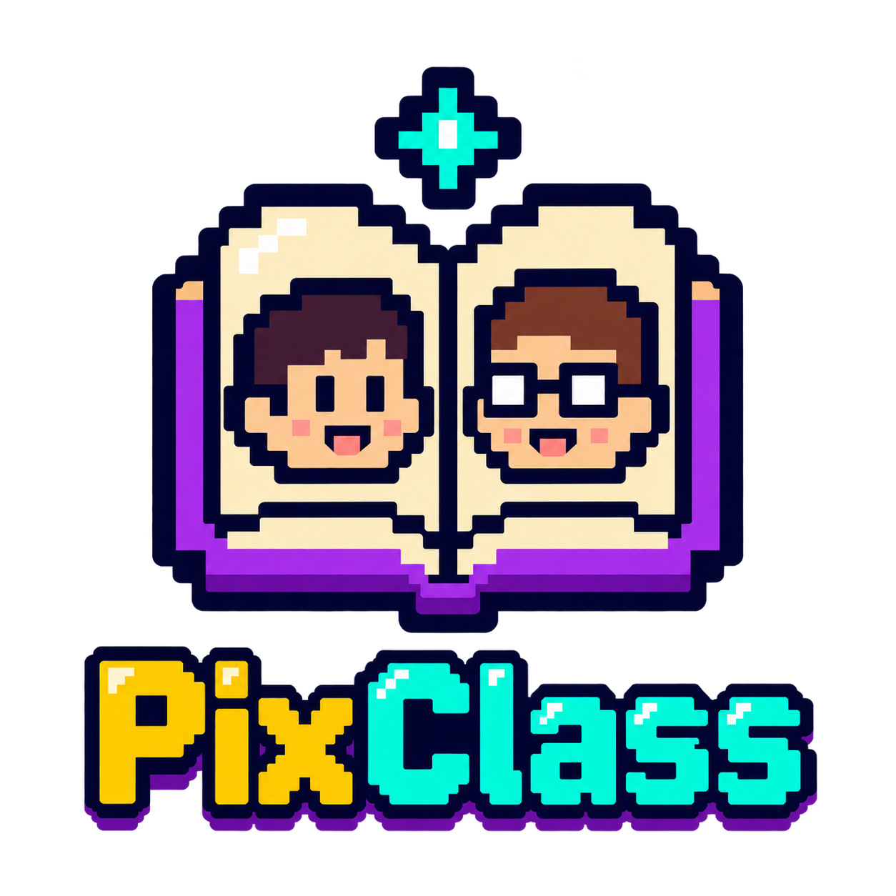
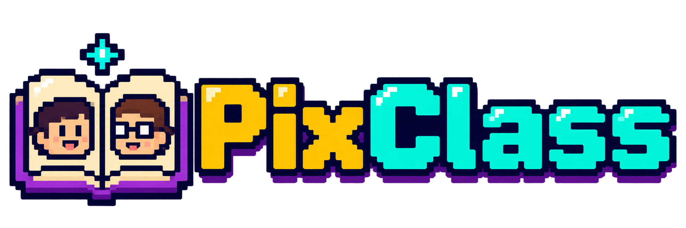

# PixClass — เกมห้องเรียนออนไลน์ Pixel Art

วันที่จัดทำ: 18 พฤศจิกายน 2026

ชื่อเดิมของโปรเจกต์: Student Tag

สถานะ: เอกสารสรุปทิศทางใหม่ ยังไม่ได้เปลี่ยนชื่อในโค้ดหรือติดตั้งระบบเกม

## 1. ชื่อและแนวคิด

**PixClass** อ่านว่า **พิกซ์คลาส** มาจาก Pixel + Class สื่อถึงห้องเรียนในโลกพิกเซล ใช้รูปสะกดนี้ให้สอดคล้องกันในงานออกแบบและเอกสารใหม่

คำโปรยที่เสนอ: **ห้องเรียนออนไลน์ เรียนรู้ไปด้วยกันผ่านเกม**

ชื่อเป็นทิศทางที่เลือกจากการสนทนา ยังไม่ได้ตรวจชื่อซ้ำ เครื่องหมายการค้า หรือโดเมน การเปลี่ยนชื่อในเอกสารนี้ไม่ใช่การเปลี่ยนชื่อฐานข้อมูล package หรือ deployment ของระบบเดิม

## 2. จุดประสงค์หลัก

เปลี่ยนการเรียนออนไลน์ที่น่าเบื่อและเน้นอ่านประกาศหรือส่งงานแบบ Google Classroom ให้เป็นเกมที่ครูกับนักเรียนมีปฏิสัมพันธ์กันมากขึ้นระหว่างการเรียนออนไลน์

ผู้เรียนต้องรู้สึกว่าเข้ามาอยู่ในห้องเดียวกับครูและเพื่อน มีตัวละครที่ควบคุมได้ เดินสำรวจ โต้ตอบกับสิ่งของ รับงาน และขอความช่วยเหลือจากครู ส่วนครูสามารถจัดกิจกรรม ตอบสนองต่อผู้เรียน และสร้างบรรยากาศของห้องตนเองได้

การเรียนและความสัมพันธ์ในห้องเป็นแกนหลัก เหรียญ สกิน และของตกแต่งเป็นแรงจูงใจสนับสนุน การเปลี่ยนธีมเว็บให้คล้ายเกมเพียงอย่างเดียวไม่บรรลุจุดประสงค์

## 3. ฟีเจอร์ที่ต้องมีตามความต้องการ

| ส่วน | ความต้องการ |
|---|---|
| รูปแบบ | เกมบนเว็บแนว 2D Pixel Art |
| ห้องเรียน | มีพื้นที่เดินและจุดโต้ตอบ เชื่อมกับการเรียนจริง |
| ปฏิสัมพันธ์ | เพิ่มการมีส่วนร่วมและการสื่อสารระหว่างครูกับนักเรียน |
| ตัวละคร | นักเรียนและครูแต่งตัวละครได้ทั้งคู่ |
| เหรียญ | นักเรียนสะสมจากการเข้าเรียนจนซื้อของแต่งตัวได้ |
| ห้องของครู | ครูแต่งห้องเรียนและจัดวางของได้ |
| Admin | ไม่มีบทบาทในเกม ร้านค้า หรือเหรียญ คงหน้าที่ดูแลบัญชีเดิม |
| ฐานระบบ | ต่อยอดบัญชี ห้อง งาน ส่งงาน คะแนน Telegram และ Live Class ที่มีอยู่ |

## 4. บทบาทผู้ใช้

### นักเรียน

- เข้าห้องที่ตนเป็นสมาชิกและควบคุมตัวละคร
- รับงาน ส่งคำตอบหรือไฟล์ อ่านคะแนนและคำแนะนำของตน
- เข้าร่วมกิจกรรมและส่งสัญญาณถึงครูผ่านระบบปฏิสัมพันธ์
- สะสมเหรียญเข้าเรียนตามเกณฑ์ ซื้อสกิน เก็บในคลัง และสวมใส่

### ครู

- เข้าห้องที่ตนสอน ควบคุมและแต่งตัวละครของตน
- สร้างห้อง ประกาศ มอบหมายงาน ตรวจงาน และให้คะแนน
- เริ่ม Live Class ดูการเข้าเรียน และตอบสนองต่อผู้เรียน
- เลือกของตกแต่งและจัดวางเฟอร์นิเจอร์ในห้องที่ตนเป็นเจ้าของ
- ซื้อสกินได้ โดยแหล่งเหรียญของครูยังต้องกำหนดก่อนพัฒนาระบบเศรษฐกิจ

### Admin

ดูแลบัญชีตามระบบเดิม เช่น สร้างบัญชีครูและระงับบัญชี ไม่มีหน้าจัดการสินค้า ราคา เหรียญ หรือการแต่งห้อง และไม่มีสิทธิ์เข้าห้องผู้อื่นโดยอัตโนมัติ

## 5. ประสบการณ์การเล่นที่เสนอ

1. ผู้ใช้เข้าสู่ระบบ เลือกห้อง แล้วเข้าโลกเกม
2. ครูและนักเรียนเห็นตัวละครของกันและกันในห้องออนไลน์
3. นักเรียนกดพร้อมเรียน ครูเรียกรวมที่จุดเรียนและเริ่มคาบ
4. นักเรียนเดินไปกระดานเพื่อรับงาน หรือใช้เมนูทางลัด
5. ระหว่างทำงาน นักเรียนยกมือหรือขอความช่วยเหลือ ครูเห็นและตอบรับ
6. นักเรียนส่งงาน ครูตรวจและให้คำแนะนำ นักเรียนดูผลส่วนตัว
7. ระบบประเมินรางวัลเข้าเรียนและบันทึกเหรียญตามกติกา
8. ผู้ใช้เลือกซื้อและแต่งตัว ครูปรับแต่งห้องให้มีเอกลักษณ์

ห้องหลายคน การยกมือ สถานะพร้อมเรียน และการเรียกรวมเป็นข้อเสนอสำหรับทำให้เป้าหมายเกิดขึ้นจริง รายละเอียดต้องยืนยันก่อนพัฒนาช่วงที่เกี่ยวข้อง ต้องมีทางลัดเข้าถึงงาน คะแนน และ Live โดยไม่บังคับเดินทุกครั้ง

## 6. แนวทางภาพและโลโก้

- ฉาก Pixel Art แบบ isometric มุมเฉียง บรรยากาศห้องเรียนอบอุ่น
- ตัวละครขนาดเล็กแนว chibi พร้อมภาพยืนและเดิน
- ภาพพื้น ผนัง เฟอร์นิเจอร์ และตัวละครแยกชิ้นเพื่อใช้งานในเกมจริง
- เมนูกรอบพิกเซล ข้อความภาษาไทยอ่านง่าย ฟอร์มและตารางใช้ HTML
- รองรับคอมพิวเตอร์และมือถือ พร้อมปุ่มโต้ตอบที่ชัดเจนและทางเลือกสำหรับ keyboard
- งานภาพร่างเป็น concept ไม่ใช่ asset เกมหรือหน้าจอที่พัฒนาเสร็จ

### โลโก้ที่ร่างไว้

โลโก้ใช้หนังสือเปิดพร้อมใบหน้าครูและนักเรียน สื่อถึงการเรียนรู้ร่วมกัน ตัวอักษร Pix สีทองและ Class สีฟ้าเทอร์ควอยซ์ พร้อมขอบสีน้ำเงินเข้มและม่วง

**แบบสี่เหลี่ยมจัตุรัส** — สัญลักษณ์ด้านบน ชื่อด้านล่าง ขนาดไฟล์ 1254 × 1254 พิกเซล:



[ดาวน์โหลดโลโก้สี่เหลี่ยม PNG](assets/pixclass-logo-square-v1.png)

**แบบแนวนอน** — สัญลักษณ์ด้านซ้าย ชื่อด้านขวา:



[ดาวน์โหลดโลโก้แนวนอน PNG](assets/pixclass-logo-concept-v1.png)

ทั้งสองไฟล์เป็นภาพร่าง raster ที่สร้างด้วยเครื่องมือ imagegen ยังไม่ได้ติดตั้งแทนโลโก้เดิมบนเว็บ ต้องตรวจความชัดที่ขนาดใช้งานจริงก่อนนำไปใช้ โดยเฉพาะ favicon ที่ควรใช้สัญลักษณ์อย่างเดียว

## 7. เหรียญ ร้านค้า และของตกแต่ง

### หลักการ

- เหรียญนักเรียนได้จากการเข้าเรียนตามเกณฑ์ของระบบ ไม่มีการเติมเงินจริง
- เหรียญและไอเทมไม่เพิ่มคะแนนวิชา และไม่ใช้แทนผลการเรียน
- เซิร์ฟเวอร์ตรวจสิทธิ์ให้เหรียญ ราคา ยอดเงิน และ ownership ของไอเทม
- ป้องกันการรับซ้ำจากรีเฟรช หลายแท็บ หลุดเข้าใหม่ หรือคำขอซ้ำ
- การเปิดหน้าเกมหรือส่ง heartbeat ไม่ได้พิสูจน์ว่าเรียนจริง ต้องแสดงข้อจำกัดให้ชัด
- การซื้อใช้ DB transaction เพื่อให้การหักเงินและเพิ่มไอเทมสำเร็จพร้อมกัน
- นักเรียนและครูมีชุดเริ่มต้นที่ใช้ฟรี และลองสวมก่อนซื้อได้ตามแบบที่พัฒนา
- ครูวางของได้เฉพาะห้องตนเอง และห้ามปิดประตู จุดเกิด หรือจุดทำกิจกรรมสำคัญ

### เรื่องที่ยังต้องตกลง

จำนวนเหรียญและเกณฑ์เวลาเข้าเรียน เพดานรางวัล แหล่งเหรียญของครู และแหล่งงบแต่งห้องยังไม่ได้ข้อสรุป กระเป๋าส่วนตัวของครูและกระเป๋าประจำห้องเป็นข้อเสนอ ห้ามหักเหรียญนักเรียนเข้ากองกลางโดยอัตโนมัติ

## 8. เทคโนโลยี

| ส่วน | แนวทาง | สถานะ |
|---|---|---|
| เมนู ฟอร์ม และหน้าเว็บ | Nuxt + Vue + TypeScript | มีอยู่แล้ว |
| ระบบเรียนและตรวจสิทธิ์ | Node.js + Express + zod | มีอยู่แล้ว |
| ข้อมูลถาวร | MariaDB/MySQL + mysql2/promise | มีอยู่แล้ว |
| เสียงและวิดีโอ | Jitsi Meet IFrame API | มีระบบเดิม ต้องทดสอบบริการจริง |
| แจ้งเตือน | grammy + node-cron | มีระบบเดิม ต้องทดสอบ Telegram จริง |
| โลกเกม 2D | Phaser + TypeScript | ข้อเสนอ ยังไม่ได้ติดตั้ง |
| ห้องออนไลน์หลายคน | Colyseus บน Node.js | ข้อเสนอ ยังไม่ได้ติดตั้ง |

ต้องยืนยันการเพิ่ม stack เกมและข้อยกเว้น WebSocket ก่อนเริ่มพัฒนา คง frontend/backend แยกอิสระ ห้าม import code/type ข้ามฝั่ง เก็บ contract HTTP ใน `docs/api.md` และสร้าง contract real-time ก่อนพัฒนาการเชื่อมต่อหลายคน

ไม่ส่งคะแนน ไฟล์งาน หรือข้อมูลส่วนตัวผ่านสถานะห้องที่ผู้เล่นทุกคนรับได้ การเข้าเกมและทุกคำสั่งที่เปลี่ยนสถานะต้องตรวจ role ความเป็นสมาชิก และอายุ session ที่เซิร์ฟเวอร์

## 9. แผนพัฒนาต่อ

| Milestone | งานหลัก | เกณฑ์ตรวจรับ |
|---|---|---|
| G1 | ห้อง Pixel ที่เล่นได้ | เดินอ้อมโต๊ะ โต้ตอบกระดาน และใช้หน้าต่างได้บนคอมพิวเตอร์/มือถือ |
| G2 | ห้องออนไลน์ร่วมกัน | ครูกับนักเรียนเห็นกัน คนนอกเข้าไม่ได้ reconnect ไม่เกิดตัวละครซ้ำ |
| G3 | ปฏิสัมพันธ์และงานเรียน | ยกมือและตอบรับได้ พร้อม flow รับงาน → ส่ง → ตรวจ → เห็นผล |
| G4 | เข้าเรียนและเหรียญ | ให้เหรียญตามเกณฑ์ ไม่เพิ่มรางวัลจากการเข้าออกหรือคำขอซ้ำ |
| G5 | ร้านค้าและแต่งตัว | นักเรียน/ครูซื้อ สวม และกลับเข้ามาแล้วชุดยังอยู่ ยอดเงินไม่ติดลบ |
| G6 | แต่งห้องของครู | จัดวางและบันทึกได้ตามสิทธิ์ ไม่ปิดทางสำคัญ และสมาชิกเห็นผังตรงกัน |

ทำทีละ Milestone ตรวจรับ อัปเดตเอกสาร และ commit ก่อนทำช่วงต่อไป รายละเอียดเกณฑ์ในแต่ละช่วงอยู่ใน [แผนเกมฉบับละเอียด](game-design.md)

## 10. การย้ายระบบและสถานะจริง

ฐานระบบเรียนเดิมมีรายงาน M1–M6 แล้ว ให้ตรวจโค้ดและรายงานก่อนเปลี่ยนแปลง ไม่สร้าง auth งาน คะแนน หรือ Telegram ซ้ำโดยไม่จำเป็น การอัปเดตเอกสารครั้งนี้ไม่ได้ยืนยันผลทดสอบ runtime ใหม่

ระหว่างย้ายต้องรักษาข้อมูลและเส้นทางส่งงานเดิม ออกแบบ migration ก่อนเพิ่มตารางเกม ห้าม import schema/seed ทับฐานข้อมูลจริงหรือเปลี่ยนชื่อ DB ตามแบรนด์โดยอัตโนมัติ ลิงก์งานและ Live จาก Telegram ต้องยังเข้าถึงเนื้อหาที่ถูกต้องได้

ระบบเกม เหรียญ ร้านค้า และแต่งห้องยังเป็นแผน โลโก้เป็นไฟล์ภาพร่าง การนำชื่อ PixClass ไปเปลี่ยน title, metadata, ข้อความในแอป และโลโก้บนเว็บเป็นงาน implementation แยกจากการสร้างเอกสารนี้

## 11. เกณฑ์ความสำเร็จ

- ครูและนักเรียนสื่อสารและตอบสนองกันระหว่างเรียนได้สะดวกขึ้น
- นักเรียนกล้าถาม ขอความช่วยเหลือ และเข้าร่วมกิจกรรมมากขึ้น
- ครูติดตามสถานะและช่วยผู้เรียนได้โดยไม่ต้องจัดการระบบเกมตลอดเวลา
- ส่งงาน อ่านคำแนะนำ และเข้าเรียนได้โดยเกมไม่เพิ่มความยุ่งยาก
- ประสบการณ์ใช้งานยังทำงานได้บนอุปกรณ์และเครือข่ายเป้าหมายที่ตกลงกัน

ต้องกำหนดค่าฐานและเป้าหมายก่อนทดลองสอนจริง ไม่ใช้ชั่วโมงออนไลน์หรือเหรียญเป็นหลักฐานผลการเรียน และไม่เพิ่ม analytics ภายนอกโดยอัตโนมัติ

## 12. ขอบเขตที่ยังไม่ทำ

XP/Level, ระบบเติมเงินจริง, โอนหรือซื้อขายของระหว่างผู้เล่น, กล่องสุ่ม, PvP, โลก MMO ข้ามโรงเรียน, แชตอิสระ/ข้อความส่วนตัว และหน้าจัดการเกมของ Admin รวมถึงข้อยกเว้นอื่นใน AGENTS.md ที่ยังไม่ได้เปลี่ยน

## 13. หน้า Homepage

### วัตถุประสงค์และขอบเขต

หน้า Homepage เป็นหน้าแนะนำ PixClass ก่อนเข้าสู่ระบบ ทำให้ผู้เข้าชมเข้าใจว่าเป็นเกมห้องเรียนออนไลน์ที่ครูกับนักเรียนเรียนรู้และทำกิจกรรมร่วมกัน และพาเข้าสู่การสมัครหรือเข้าสู่ระบบได้ชัดเจน

ส่วนนี้เป็นสเปกหน้าใหม่ที่เสนอ ยังไม่ได้สร้างหน้าเว็บจริง การตกแต่งด้วย Pixel Art ต้องสื่อถึงประสบการณ์เล่นเกม โดยเน้นปฏิสัมพันธ์และการเรียนมากกว่าร้านค้า

### โครงหน้าและข้อความ

| ส่วน | เนื้อหาที่แสดง | การทำงาน |
|---|---|---|
| Header | โลโก้ PixClass, เมนู “รู้จัก PixClass”, “สำหรับใคร”, “เริ่มอย่างไร”, ปุ่ม “เข้าสู่ระบบ” | เมนูเลื่อนไปยัง section ในหน้า ปุ่มเข้าสู่ระบบเปิด `/login` |
| Hero | หัวข้อ “เปลี่ยนห้องเรียนออนไลน์ ให้กลายเป็นโลกที่เราเรียนรู้ด้วยกัน” คำอธิบาย “พบครูและเพื่อนผ่านตัวละครพิกเซล ทำกิจกรรม รับงาน และเติบโตไปด้วยกันใน PixClass” | ปุ่มหลัก “เริ่มต้นใช้งาน” เปิด `/register` ปุ่มรอง “ดูแนวทางการเล่น” เลื่อนไปส่วนขั้นตอน |
| ภาพหลัก | ฉากห้องเรียน Pixel Art มีครูหน้ากระดาน นักเรียนยกมือ และเพื่อนกำลังทำกิจกรรม พร้อมตัวอย่างสถานะ “พร้อมเรียน” และ “ขอความช่วยเหลือ” | ภาพประกอบ ไม่โหลด engine หรือเปิดห้องออนไลน์จริงจากหน้าแนะนำ |
| จุดเด่น | “อยู่ในห้องเดียวกัน”, “เรียนผ่านการลงมือทำ”, “สร้างตัวตนในห้องเรียน” | การ์ดอธิบายการพบครู/เพื่อน การรับส่งงานและ feedback การแต่งตัวและแต่งห้อง |
| สำหรับใคร | การ์ด “สำหรับนักเรียน” และ “สำหรับครู” | แสดงความสามารถจริงตาม role และเส้นทางเริ่มต้นที่เหมาะสม |
| ขั้นตอนเริ่มต้น | 1. เข้าสู่ระบบ 2. เข้าห้องเรียน 3. เรียนและโต้ตอบร่วมกัน 4. สะสมเหรียญและแต่งตัว | แสดงขั้นตอนสั้นพร้อมภาพพิกเซลประกอบ |
| ภาพประสบการณ์ | ตัวอย่างห้องเรียน หน้าต่างงาน แต่งตัวครู/นักเรียน และโหมดครูแต่งห้อง | มีคำบรรยายและระบุสถานะภาพร่างเมื่อยังไม่ใช่ภาพระบบจริง |
| CTA ท้ายหน้า | “ห้องเรียนที่มีชีวิต เริ่มจากการเข้ามาเรียนด้วยกัน” | ปุ่ม “สมัครบัญชีนักเรียน” เปิด `/register` และ “เข้าสู่ระบบ” เปิด `/login` |
| Footer | โลโก้ ชื่อ PixClass และคำอธิบายสั้นของโปรเจกต์ | ไม่เพิ่มลิงก์ติดต่อ โซเชียล หรือนโยบายที่ยังไม่มีหน้ารองรับ |

### เนื้อหาสำหรับแต่ละบทบาท

**สำหรับนักเรียน:** พบครูและเพื่อนในโลกพิกเซล รับและส่งงาน ยกมือขอความช่วยเหลือ ดูคำแนะนำ สะสมเหรียญเข้าเรียน และเลือกแต่งตัวละครของตนเอง

**สำหรับครู:** สร้างพื้นที่เรียน มอบหมายและตรวจงาน เห็นสัญญาณจากนักเรียน เริ่ม Live Class แต่งตัวละคร และจัดห้องให้เหมาะกับชั้นเรียน

ปุ่มสมัครต้องระบุว่าเป็นบัญชีนักเรียนตามระบบ auth เดิม สำหรับครูให้ใช้ข้อความ “ใช้บัญชีครูที่ได้รับจากผู้ดูแลระบบ” และปุ่มเข้าสู่ระบบ ไม่เสนอสมัครครูด้วยตนเอง Admin ไม่ปรากฏเป็นตัวละครหรือบทบาทเกมบนหน้าแนะนำ

### ร่างโครงหน้าบนคอมพิวเตอร์

```text
┌──────────────────────────────────────────────────────────────┐
│ PixClass   รู้จัก PixClass  สำหรับใคร  เริ่มอย่างไร  เข้าสู่ระบบ │
├───────────────────────────┬──────────────────────────────────┤
│ เปลี่ยนห้องเรียนออนไลน์   │                                  │
│ ให้กลายเป็นโลกที่เรา      │   ภาพฉากห้องเรียน Pixel Art      │
│ เรียนรู้ด้วยกัน           │   ครู + นักเรียน + ปฏิสัมพันธ์   │
│ คำอธิบายสั้น             │                                  │
│ [เริ่มต้นใช้งาน]         │                                  │
│ [ดูแนวทางการเล่น]        │                                  │
├───────────────────────────┴──────────────────────────────────┤
│ อยู่ในห้องเดียวกัน │ ลงมือเรียนและรับคำแนะนำ │ สร้างตัวตน    │
├──────────────────────────────┬───────────────────────────────┤
│ สำหรับนักเรียน              │ สำหรับครู                    │
├──────────────────────────────┴───────────────────────────────┤
│ ขั้นตอนเริ่มต้น → ภาพประสบการณ์ → ปุ่มเริ่มต้น → Footer       │
└──────────────────────────────────────────────────────────────┘
```

### ทิศทางภาพและ responsive

- ใช้โลโก้แนวนอนใน Header ส่วนโลโก้สี่เหลี่ยมใช้ในพื้นที่แนะนำแบรนด์ที่มีพื้นที่เพียงพอ
- พื้นหลักน้ำเงินเข้ม/ม่วงเข้ม แผงข้อความทึบอ่านง่าย ใช้ทองและฟ้าเทอร์ควอยซ์เป็นสีเน้นตามโลโก้ ต้องตรวจ contrast ก่อนใช้งานจริง
- ให้ภาพห้องเป็นจุดเด่น แต่ไม่วางข้อความยาวทับฉากที่มีรายละเอียดมาก ข้อความและปุ่มต้องเป็น HTML ไม่ฝังในรูป
- ใช้ฟอนต์ภาษาไทยที่เก็บเอง ปุ่มกรอบพิกเซล ไอคอนสไตล์เดียวกัน และ animation เบาที่ปิดได้ตาม reduced motion
- คอมพิวเตอร์วางข้อความ Hero ซ้าย ภาพขวา มือถือเรียงข้อความ → ปุ่ม → ภาพ การ์ดเรียงแนวตั้งและไม่มี horizontal scroll
- เมนูมือถือมีปุ่มเปิด/ปิดที่ระบุชื่อและสถานะ ใช้ keyboard ได้ ปุ่มกดมีพื้นที่อย่างน้อย 44 × 44 CSS pixels
- ภาพใต้จอแรกโหลดภายหลัง จองขนาดภาพเพื่อไม่ให้หน้าเลื่อนกระโดด ไม่โหลด Phaser/Jitsi หรือเปิด WebSocket บนหน้าแนะนำ

### Routing และสถานะผู้ใช้ที่เสนอ

ปัจจุบัน `/` redirect ตาม role ต้องปรับอย่างตั้งใจเมื่อเริ่ม implementation เพื่อรองรับหน้าแนะนำสาธารณะ:

- ผู้ยังไม่ login: เปิด `/` เห็น Homepage, `/login` และ `/register` เข้าถึงได้โดยไม่ถูก auth guard วนกลับ
- ผู้ login แล้ว: เปิด `/` เห็นหน้าแนะนำพร้อมปุ่ม “กลับสู่ห้องเรียน” แทนปุ่มสมัคร โดยไป `/student` หรือ `/teacher` ตาม role; Admin ไป `/admin` พร้อมป้าย “จัดการระบบ”
- หลัง login สำเร็จ: คง landing ตาม role และ redirect ไปงาน/Live ที่มีสิทธิ์เมื่อเปิดจากลิงก์เดิม ห้ามเปลี่ยนทุกเส้นทางให้กลับ Homepage
- ตรวจ role/session จากระบบเดิม ไม่เพิ่ม endpoint สำหรับข้อมูลผู้เรียนสาธารณะหรือเผยรายชื่อ/คะแนนบน Homepage

หากเลือกให้ `/` เป็น Homepage ต้องปรับ `auth.global.ts`, หน้า index และลิงก์กลับหน้าแรกที่เกี่ยวข้องพร้อมกัน โดยตรวจโค้ดจริงก่อนแก้ และไม่ทำให้ route guard หรือ deep link เดิมเสีย

### ความถูกต้องของเนื้อหา

ก่อนเกมเปิดใช้จริง ต้องระบุ “ภาพแนวคิด — ระบบเกมอยู่ระหว่างพัฒนา” ใกล้ภาพและส่วนที่อธิบายฟีเจอร์ที่ยังไม่พร้อม ปุ่มต้องอธิบายว่าจะเข้าสู่ระบบเวอร์ชันปัจจุบัน ไม่เขียนว่า “เล่นเลย” จนกว่าจะเข้าเล่นได้จริง

ไม่ใช้จำนวนผู้ใช้ รีวิว รางวัล สถานะผู้เล่นออนไลน์ หรือผลลัพธ์การเรียนที่แต่งขึ้น ไม่แสดงตัวอย่างคะแนน/ชื่อจากข้อมูลนักเรียนจริง ใช้ตัวละครสมมติสำหรับสื่อประชาสัมพันธ์

### ขอบเขตไฟล์เมื่อเริ่มพัฒนา

- `frontend/pages/index.vue`: ประกอบ Homepage และกำหนด title/metadata ของ PixClass
- `frontend/components/home/`: แยก Header, Hero, การ์ดบทบาท ขั้นตอน และ Footer ตามความจำเป็น
- `frontend/public/brand/` และ `frontend/public/game/`: ไฟล์โลโก้และภาพที่คัดเลือกสำหรับใช้งานจริง เก็บไฟล์ concept ใน docs ไว้เป็นประวัติ
- `frontend/assets/css/`: สี typography และรูปแบบหน้าใหม่ โดยไม่เปลี่ยน CSS หน้าส่งงานหรือ Gradebook จนเสียรูปแบบ
- `frontend/middleware/auth.global.ts` และจุด redirect ที่เกี่ยวข้อง: เปิด Homepage สาธารณะและรักษาเส้นทางที่ต้อง login
- Backend: ใช้ระบบ auth เดิม ไม่เพิ่ม business logic หรือเปลี่ยน schema สำหรับหน้าแนะนำอย่างเดียว

### เกณฑ์ตรวจรับ Homepage

1. ผู้เข้าชมเข้าใจเป้าหมายของ PixClass จาก Hero และเห็นทางสมัครนักเรียน/เข้าสู่ระบบชัดเจน
2. ปุ่ม เมนู และ anchor ใช้งานได้ ไม่มีปุ่มสมมติหรือลิงก์ไปหน้าที่ยังไม่มี
3. ตรวจ guest, student, teacher และ admin รวมถึงลิงก์งาน/Live หลัง login ไม่ redirect วนและไม่เปิดข้อมูลข้ามสิทธิ์
4. อ่านไทยได้ครบและใช้งานได้ที่ความกว้าง 375, 768, 1024 และ 1440 CSS pixels พร้อม keyboard/focus และ reduced motion
5. แยกภาพร่างกับฟีเจอร์ที่ใช้ได้จริง และไม่แสดงข้อมูลนักเรียนบนหน้าสาธารณะ
6. รัน frontend typecheck/build และ tests ที่เกี่ยวกับ routing/auth เมื่อมีการแก้ logic พร้อมอัปเดต README ก่อนรายงานว่าเสร็จ

## 14. เอกสารอ้างอิงภายใน

- [AGENTS.md](../AGENTS.md): กติกาพัฒนา stack และความปลอดภัย
- [README.md](../README.md): วิธีติดตั้งและรันระบบปัจจุบัน
- [Game design](game-design.md): รายละเอียดระบบเกม ข้อเสนอ และแผน G1–G6
- [API contract](api.md): API ที่พัฒนาแล้ว

เอกสารนี้เป็นภาพรวมแบรนด์และจุดประสงค์ใหม่ของ PixClass ไม่แทนที่กติกาความปลอดภัย สัญญา API หรือรายงานตรวจรับของระบบเดิม รายการที่ระบุเป็นข้อเสนอต้องไม่ถูกตีความว่าผู้ใช้ยืนยันแล้ว
